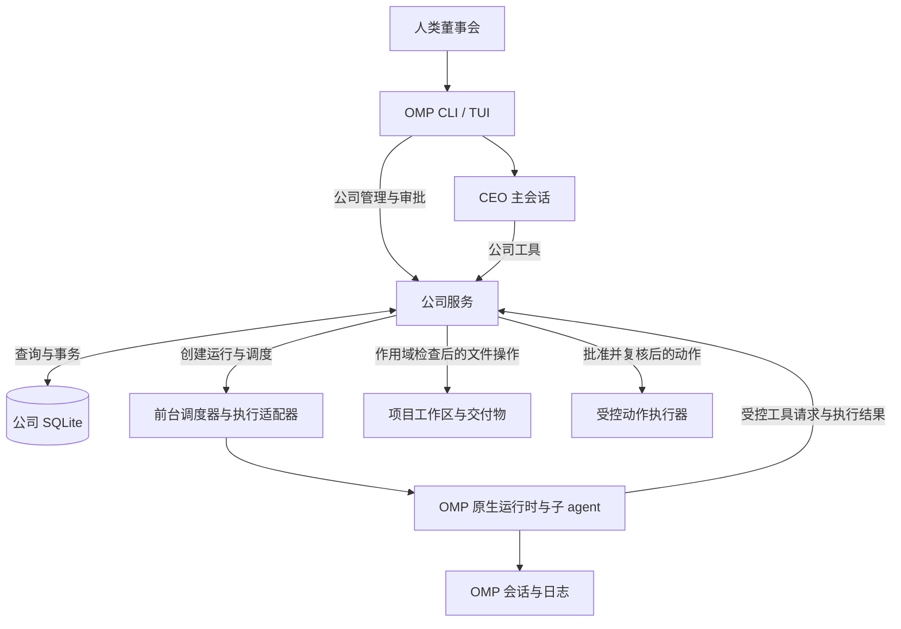

# OMP 公司模式总体思想与架构

这份文档记录[公司模式总方案](README.md)的架构基线，用于指导 P0 验证和后续实现。具体接入点、交付顺序和验收条件见[实施计划](implementation-plan.md)，任务进展见[实施台账](implementation-tracker.csv)。

## 总体思想

1. **公司负责长期组织，OMP 负责实际执行。** 公司服务持有目标、人员、工作和治理状态。现有 OMP 运行时继续提供模型、工具、会话和子 agent。通过一个窄的执行适配接口连接两者。
2. **工作项是协作单位。** 人和 agent 通过任务、提交、审核及决定推进工作。报告线帮助分工和升级，实际执行深度服从 OMP 运行时规则。重要结论落到任务、文档或决策记录。
3. **跨会话靠持久事实。** CEO 主对话是董事会入口，员工会话承载一次或多次工作上下文。进入新会话时，从公司现状和相关记录重建所需上下文。公司、成员、任务和运行分别拥有稳定标识。
4. **判断可以由 agent 提出，权限与状态由系统裁决。** 对话内容可表达意图或建议。具有实际效果的写入、派工、审核、审批和操作由受控入口验证身份和状态后落库或执行。
5. **先跑通本地闭环。** 首版在现有 OMP 进程内运行公司服务和调度器，使用本地 SQLite。成员按需启动，状态在退出后保留。每个 profile 一次激活一家公司，同一工作区串行写入，后续再按任务引入并行工作区。

## 逻辑架构

| 组件 | 职责 |
|---|---|
| CLI / TUI 和 CEO | 选定当前公司，恢复 CEO 对话，展示组织、任务、审核和审批。董事会的确认通过受信的交互入口记录。 |
| 公司服务 | 管理组织身份、项目范围、任务状态、审核、动作审批、决策和审计。CEO、员工与终端界面通过同一业务入口查询和修改公司状态。 |
| 前台调度器和执行适配器 | 从符合条件的工作项创建运行，执行并发和工作区限制，为 OMP 构造可信的运行上下文，通过现有子 agent 入口运行、取消并采集结果。 |
| OMP 原生运行时 | 负责模型调用、会话、工具调用、执行结果和原生日志。复用已有的子 agent 和工作区机制。 |
| 受控工具与动作执行器 | 按当前授权处理工作区读写和外部动作，核对审批绑定并记录动作结果。通过工具配置将敏感凭证留在受控执行路径。 |

### 数据归属与身份

| 数据 | 权威来源 | 关联方式 |
|---|---|---|
| 公司、目标、组织、项目、任务、审批、决策及运行状态 | 公司 SQLite | 归属和授权查询均按公司及项目范围。任务的负责人独立于当前占用的执行。 |
| OMP agent 定义、会话和原生日志 | OMP 配置和会话存储 | 成员绑定经授权的 agent 定义。CEO 入口引用对应会话，执行尝试引用自己的 OMP 会话和日志。 |
| 代码、文档版本和交付物 | 项目工作区及持久产物位置 | 公司库保存受控引用和版本依据，例如提交 ID、版本或摘要。审核和审批通过这个依据定位具体交付物或资源。 |

调度器从可信的入口确定 `company_id`、`member_id`、`project_id`、`task_id` 和 `run_id`，给执行适配器传入已验证的工作目录、有效工具权限和取消信号。模型给出的资源引用要在此作用域内解析。更换模型、会话或成员时，服务按新配置校验权限，原工作和审核记录继续可查。文档索引与摘要等派生数据继承同一访问范围，恢复时以正式任务、决定和版本引用为准。

## 一次工作怎样完成

1. 董事会在 CEO 入口提出目标。CEO 通过公司工具建任务并指派，部门负责人追加子任务、阻断依赖和验收标准。
2. 在 OMP 打开的期间，显式派单或评审请求触发调度。公司服务检查身份、项目、依赖、占用和执行条件。在一个短事务内写入任务认领、运行尝试和审计事件。
3. 执行适配器通过现有 OMP 子 agent 原语启动成员。模型调用和文件操作发生在数据库事务之外。工作区写入还需要目录级互斥或独立工作区。
4. 执行结束后先登记可复核的制品版本或失败原因，再按当前 `run_id` 回写执行结果。提交成功后，工作项进入待审核。
5. QA 对指定成果版本作出通过或打回的结论。打回保留提交和评审历史，可创建新的执行尝试。发布等受控动作另行申请审批，由授权人确认目标、参数、版本和时效。执行前再次核对授权，结果和对应回执进入审计。CEO 从公司记录汇报进展。

## 并发、取消与恢复

**三类状态分别管理。** 工作项表示业务进度，运行尝试表示一次具体执行，动作审批表示某个授权请求及其执行结果。会话记录帮助追溯。业务状态通过公司服务按已验证结果更新。

| 场景 | 处理规则 |
|---|---|
| 两个执行请求认领同一任务 | 事务只为一个请求建立有效运行。完成、释放和提交结果都校验当前 `run_id`。迟到结果保留诊断信息并拒绝写入当前状态。 |
| 不同任务写入同一工作区 | 首版按规范化后的物理目录互斥，覆盖跨项目指向同一目录。以后按任务分配 worktree，审核绑定版本，合并单独协调。 |
| 取消、进程中断或切换公司 | 停止派工，等待执行结束或确认不可继续写入，再释放工作区。重开公司时核对认领记录、执行日志和产物。OMP 通用会话续跑路径可能重跑中断工具调用，公司运行按独立的恢复规则处理。 |
| 外部动作提交后回执未知 | 用同一个业务幂等键查询或对账，重试沿用该键。无法确认时保留待核实状态，等待人工处理。 |
| CEO 会话或项目目录缺失 | CEO 从公司现状重建上下文。项目目录缺失时暂停该任务并提示修复。 |

## 权限边界与演进

- **首版工具边界。** 以可信入口分配工具白名单，最终工具集合、资源路径和模型来源在启动或调用时复核。首版只暴露经过验证的公司工具和工作区能力，应用层审计作用于这些入口。需要运行拥有完整 shell 或宿主凭证的成员时，按具体风险选择进程、操作系统或沙箱隔离。
- **部署边界。** 每个 OMP profile 一次激活一家公司，公司内可按需运行多个成员。现有 OMP 注册表与部分上下文具有进程级行为，P0 要验证切换与隔离。关闭 OMP 后，持久任务保留待查，常驻调度按后续范围另行启用。
- **演进顺序。** P0 验证执行接点、受限工具、会话切换、认领和取消。P1 做本地闭环。P2 延伸到并行工作区、恢复、收件箱和用量账本。P3 补齐多项目、即时沟通、文档检索与细粒度权限预算。公司级预算使用可计量请求的额度预留与结算，首版使用现有会话费用门槛。

P0 可根据验证结果调整适配接口、worker 路由和恢复实现，沿用实施计划的 V-01、V-02、V-03 和 V-06 作为可重跑场景。涉及角色边界、持久状态归属或审批语义的变更同步更新总方案和本页。 [子 agent 执行原语](../../packages/coding-agent/src/task/structured-subagent.ts) · [SDK 工具过滤](../sdk.md#tools-and-extension-integration) · [OMP 通用恢复](../../packages/coding-agent/src/task/restore.ts) · [会话费用门槛](../../packages/coding-agent/src/session/cost-gate.ts)
